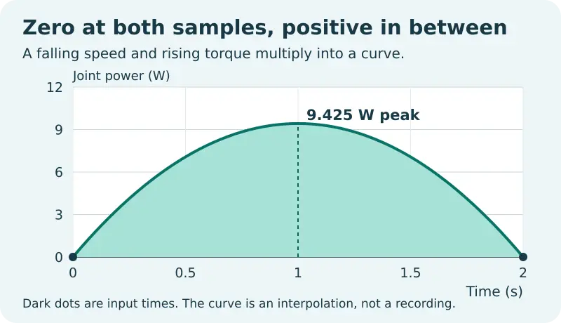
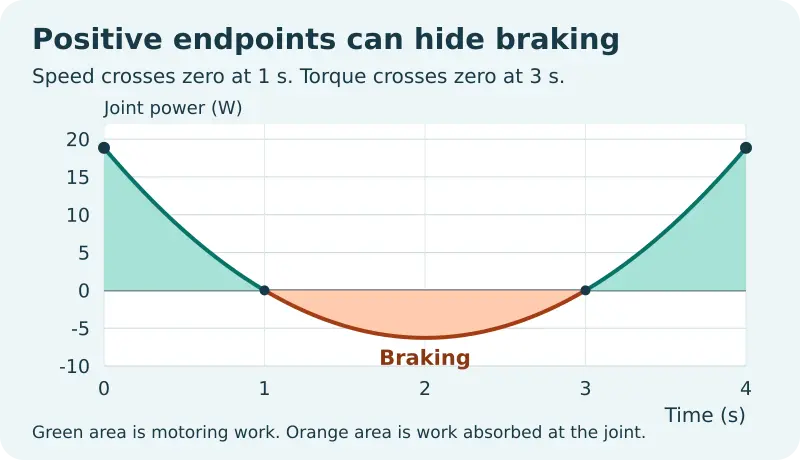

# Robot Joint Power Calculation in Python

Analyze a timestamped torque and speed trace at one rotary robot joint. This offline lab reports peak motoring and braking power, the energy in each direction, net work and mean signed power.

[Read the full WIFA Robotics lesson](https://wifarobotics.com/learn/robot-joint-power-calculation/)

## Start with an empty terminal

1. Install a supported Python 3.11 or newer from [Python.org](https://www.python.org/downloads/). Run `python3 --version` on macOS or Linux, or `py -3 --version` on Windows.
2. On the repository page choose **Code**, then **Download ZIP**. Extract the folder and open a terminal inside it. Check for `joint_power.py` with `ls` on macOS or Linux, or `dir` on Windows. No Git or third party Python package is required.
3. Run the commands below. On Windows replace each `python3` with `py -3`.

```sh
python3 joint_power.py examples/hold.csv
python3 joint_power.py examples/coupled-ramp.csv
python3 joint_power.py examples/two-crossings.csv
python3 joint_power.py examples/stop-and-return.csv
python3 -m unittest discover -s tests -v
```

| Example | Peak motoring (W) | Peak braking magnitude (W) | Motoring energy (J) | Braking energy magnitude (J) | Net (J) |
| --- | ---: | ---: | ---: | ---: | ---: |
| Hold | 0 | 0 | 0 | 0 | 0 |
| Coupled ramp | 9.425 | 0 | 12.566 | 0 | 12.566 |
| Two crossings | 18.850 | 6.283 | 16.755 | 8.378 | 8.378 |
| Stop and return | 25.133 | 25.133 | 18.850 | 18.850 | 0 |

Values in the table are rounded. The CLI prints JSON with nine significant digits. Mean signed power equals net work divided by duration, not the average of the row powers.



## Try a change

Copy `examples/coupled-ramp.csv` to `examples/faster.csv`. Change the first speed from 60 to 120 rpm and leave the duration and torque unchanged. The peak should become about 18.850 W and the motoring energy about 25.133 J. To change the coordinate direction, negate **both** torque and speed. That leaves the power unchanged.

Use the exact header `time_s,torque_nm,speed_rpm`. Provide at least two rows, with finite numbers and strictly increasing nonnegative time. Use seconds, newton metres and signed revolutions per minute. Keep each input magnitude within 1e9. Convert motor shaft readings before pairing them with output joint readings: both quantities must refer to the same shaft, time and positive direction. Commanded torque and actual torque are different signals.

## How to read the result

Torque times angular speed in rad/s gives signed power. A positive value transfers mechanical energy from the actuator to the joint; a negative value transfers mechanical energy the other way under the sign convention used here. The model linearly interpolates **each input** between samples, so their product is quadratic. It integrates each region separately at zero crossings and checks interior peaks. Two positive sample products can therefore hide a braking interval in the modeled curve.



If a file fails to open, check your terminal folder and file name. If the header fails, check the column order and make sure your editor exports commas, not semicolons. For a speed given in rad/s, convert to rpm by multiplying by 60 divided by 2π. Convert milliseconds to seconds before analysis. If energy looks inconsistent, check for duplicated timestamps, torque or encoder signs, and whether channels were sampled together. Do not increase the sample rate by interpolation and treat the result as new measurements.

The tests include four hand worked examples and a seeded comparison against 400 exact rational polynomial integrals. To regenerate the editable SVG and WebP figures on a system with Inkscape, ImageMagick and DejaVu Sans installed, run `python3 diagrams/render.py`. Those tools are optional for the project itself.

All supplied data are synthetic. The model describes one rotary joint and does not infer torque, reconstruct events between real samples, predict holding current or temperature, or calculate wall energy, drive recovery or braking resistor requirements. Negative shaft work alone gives no evidence that a particular drive regenerates electricity.

## References

* [OpenStax: Work and power for rotational motion](https://openstax.org/books/university-physics-volume-1/pages/10-8-work-and-power-for-rotational-motion)
* [Northwestern University: Modern Robotics, actuation, gearing and friction](https://modernrobotics.northwestern.edu/nu-gm-book-resource/8-9-actuation-gearing-and-friction/)
* [NIST DLMF: Simpson’s rule](https://dlmf.nist.gov/3.5#ii)
* [Python 3.12: CSV reading and writing](https://docs.python.org/3.12/library/csv.html)
